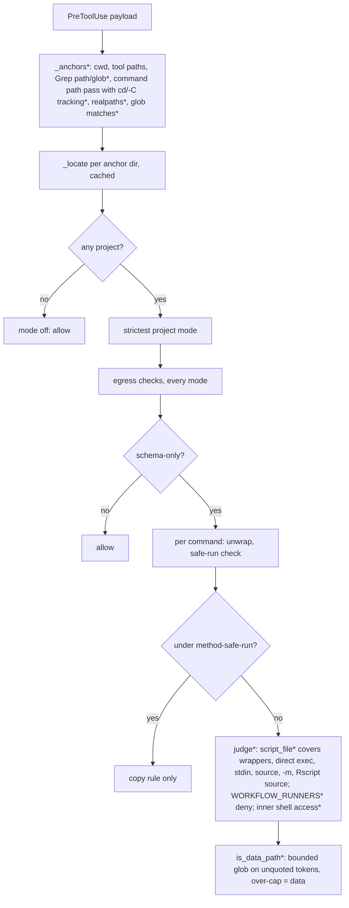

# PHI Guard Fail-Open Hardening and Evidence-Access Unification - Plan

## Goal Capsule

- **Objective:** A researcher working in a schema-only methodsmith project cannot get data values into the model context through any command shape a fresh review reproduced (script launchers, relative paths from a parent folder, shell wildcards, oversized projects, or verbose stderr). The 24 evidence skills give one consistent literature-access instruction.
- **Means:** Close each reproduced bypass in `plugins/methodsmith/hooks/data-boundary-guard.py` and `plugins/methodsmith/scripts/method-safe-run` with a failing regression test first (KTD1-KTD7). Rebuild `evidence-access.md` as a shared canonical block plus skill-local sections (KTD8).
- **Authority:** This plan's Requirements and KTDs. Then `AGENTS.md`. Then the guard docstring, which U6 updates to match.
- **Stop conditions:** Stop and report if a fix would make an `approved` or `no-sensitive-data` project lose access it has today, or if a fix pushes the guard's per-call decision past the latency budget in R9 and no cap restores it.
- **Execution profile:** Test-first per bypass. Ships on branch `refactor/state-dir-rename-and-hardening` together with the uncommitted state-folder rename work already on that branch.
- **Tail ownership:** The calling pipeline (LFG) owns review, commit, push, and the PR.

---

## Product Contract

### Summary

Close the four remaining reproduced fail-open classes in the PHI data-boundary guard and `method-safe-run`, and replace the drifted `evidence-access.md` copies in all 24 evidence skills with one canonical shared block pinned by a test. Every fix lands with a synthetic-data regression test that fails before the change.

### Problem Frame

An independent audit of the guard reproduced eight fail-open paths against synthetic data. Four were fixed earlier on this branch (`rg -L`, negated globs and `--type-add`, MCP data reads, legacy-folder tightening). The remaining four classes still let a schema-only project leak rows: common ways of launching a script skip the static script check, a session started in a parent folder resolves the mode to `off`, shell wildcards defeat the extension check, and `method-safe-run` stops recording outputs past 20,000 files while printing unmasked stderr. Run from a folder with no project, it also writes its outputs list where the guard never looks, so those outputs stay readable. Separately, `evidence-access.md` has drifted into nine variants across 24 skills even though `tests/evidence-access-contract.test.ts` describes one shared block. Each skill now gives slightly different tool names and fallbacks.

### Key Decisions

- **Hard rename of the per-project state folder to `.methodsmith/`.** The old `.ce-datascience/` is never trusted for mode and is read only for settings that tighten the boundary. (session-settled: user-directed — chosen over a dual-read migration that falls back to the old folder's mode: the user picked the hard rename explicitly.) Governs R13.
- **No `!` or `BREAKING CHANGE:` marker.** The PR body flags the breaking surface instead. (session-settled: user-directed — chosen over marking the change breaking to trigger a 6.0 release: the major-bump decision belongs to the maintainer and is unanswered.) Governs R14.
- **Deprecated `/ce-*` alias generation stays removed.** (session-settled: user-approved — chosen over writing deprecated aliases for another release: the aliases promised removal at the next major, which this breaking change implies.) Governs R14.

### Requirements

**Script execution (schema-only)**

- R1. A script whose source reads data is denied however it is launched: through a run wrapper (`uv run`, `poetry run`, and the other `RUN_WRAPPERS`), by direct path (`./x.py`, `analysis/run.sh`, using extension or shebang), fed on stdin (`python3 - < x.py`, `python3 < x.py`, `cat x.py | python3`), via `source`/`.`, via `python -m pkg.mod` when the module resolves to a project file (including directories in an inline `PYTHONPATH=` assignment), or via `Rscript -e "source('x.R')"`.
- R2. The access result of code run through `sh -c`/`bash -c`/`eval` applies, not only its egress result, except when the whole command runs under the plugin's `method-safe-run`.
- R3. Workflow runners (`make`, `snakemake`, `nextflow`, `dvc repro`, `pytest`, `tox`, `nox`, `just`, `invoke`, `task`, package-script runners such as `npm run`, `pnpm run`, `yarn run`, and `bun run` with a non-file target, `papermill`, `kedro run`, `dbt run`, `quarto render` without a file, `Rscript -e` calling `targets::tar_make` or `rmarkdown::render`, and `R CMD BATCH`) are denied in schema-only unless they run under `method-safe-run`. The deny reason names `method-safe-run` as the way to run them.

**Mode resolution**

- R4. A command, Read, or Grep that targets a project through a relative path, a `cd`/`pushd` target, `git -C`, `make -C`/`--directory`, or a symlink resolves that project's mode even when the session cwd is outside it. When several projects are named, the strictest mode wins.
- R5. Mode resolution has no fixed anchor cap that lets a later path in the same command go unchecked.

**Wildcards**

- R6. An unquoted shell wildcard that matches a data file is treated as a data reference. A wildcard expansion that exceeds the cap is treated as a data reference (fail closed). Quoted patterns passed to tools such as `find -name` are not expanded.

**method-safe-run**

- R7. Files a run writes are recorded in `outputs.txt` regardless of project size, including files written with preserved timestamps.
- R8. The printed stderr tail carries no free-text values: only frame paths, line numbers, exception type names, and a line count. The full stderr stays in the local log.
- R12. `method-safe-run` refuses to run when it finds no project marker (`.methodsmith/` or `.git`) above the working directory, rather than creating `.methodsmith/` in an arbitrary folder.

**Performance and contract**

- R9. One guard decision completes in under 1 second on the test fixtures and in under 3 seconds on a 100,000-file tree, well inside the 10-second hook timeout.
- R10. Every guard and safe-run fix has a regression test with synthetic data that fails before the change, and deny reasons never echo matched data values.

**Evidence access**

- R11. All 24 evidence skills ship a byte-identical canonical evidence-access block at the top of `references/evidence-access.md`, followed only by skill-local sections. `method-pubmed` may differ in its fallback line because it owns the E-utilities fallback.

**Carried constraints**

- R13. Legacy-folder behavior stays as already implemented on this branch: schema-only, tighten-only reads, and helpers refuse with the `mv` command.
- R14. The PR flags the state-folder rename and `/ce-*` alias removal as breaking, with no `!` marker.

### Scope Boundaries

- Obfuscation the parser cannot see (variables holding command names, dynamically built paths, encoded payloads) stays out of scope, as the guard docstring already states.
- No change to approved or no-sensitive-data access behavior. Egress checks keep applying in every mode.
- No PATH or `.venv/bin` lookup for direct exec. Only tokens containing `/` or a script extension count as scripts, so `uv run ruff check .` stays allowed.

### Deferred to Follow-Up Work

- Mode-aware stderr masking in `method-safe-run` (reading the project config) if users find the strict tail too terse in approved projects.
- A `docs/solutions/` learning that records the guard's fail-mode and heuristic-limit rules (owned by `ce-compound` after this ships).

---

## Planning Contract

### Key Technical Decisions

- KTD1. **Normalize launch shapes to one "script file" check.** Extend `script_file` and `judge` so every R1 shape resolves to a script path that `script_reads_data` scans. Direct exec applies only to a program token containing `/` or a `SCRIPT_EXTS` extension, and the resolved file is scanned only when it has a `SCRIPT_EXTS` extension or starts with a `#!` line naming a known interpreter; bare names are never resolved, and compiled binaries are never read. For an extensionless file, the shebang interpreter picks the scan mode, so a shell shebang gets the recursive shell scan. Stdin-fed interpreters take the file after `<` or the file a preceding `cat` pipes in. A module path that cannot be resolved to a project file is allowed, because installed modules such as `pytest` or `http.server` cannot be mapped. Implements R1.
- KTD2. **Merge inner shell access the same way substitutions already do.** `bash_violations` keeps both results of `shell_code(cmd)` (mirroring the substitution and heredoc branches), evaluated after the `safe` check so `method-safe-run -- bash -c "..."` keeps its exemption. Implements R2.
- KTD3. **Workflow runners move from allow-outright to deny-in-schema-only.** Replace the inline allow tuple in `judge` with a `WORKFLOW_RUNNERS` set (plus the `Rscript -e` render/`tar_make` pattern). In schema-only they deny unless `safe`. In other modes they never reach `judge`'s access path, so `make test` stays allowed there. This accepts false positives in schema-only projects (for example `pytest` on code-only tests) in exchange for closing the bypass. Implements R3.
- KTD4. **Anchors come from a lightweight path pass over the command, not a cap.** `_anchors` tokenizes the command with the existing tokenizer and walks segments. It tracks `cd`/`pushd` targets and `-C`/`--directory` options. Each token is split into path-like chunks (the `_chunks`/`text_ref` split), and a chunk becomes an anchor when it contains `/`, carries a data extension, or exists on disk relative to the effective directory (the same `lexists` rule `token_ref` uses, so a bare `proj` counts). The pass recurses into `shell_code(cmd)`, command substitutions, and heredoc bodies with their own effective directory. Each anchor is added in literal and `realpath` form. `_locate` results are cached for every directory visited on the upward walk and by git top, and `_project_mode` is memoized per `(ce_root, main)`, so dropping the 20-anchor cap does not multiply walks, config reads, or `git rev-parse` calls. Grep already anchors its `path`; the literal directory prefix of its `glob` becomes an anchor too. Implements R4, R5, R9.
- KTD5. **Bounded glob expansion on unquoted shell tokens, schema-only.** Quoting is detected before `shlex` strips it (a quote-preserving scan of the original token span). On the shell-token path only, unquoted `*`, `?`, and `[` tokens are expanded with `glob` relative to the effective directory, stopping at 256 matches; inline-code and script literals keep the existing `DATAISH_DIRS` wildcard heuristic. In schema-only access checks an over-cap expansion counts as a data reference; in every other mode, and for egress, only the matches found before the cap are checked, so approved and no-sensitive-data projects lose no access. A quoted `find -name/-iname/-path/-ipath` pattern is not expanded but is matched with `fnmatch` against the data extensions and data roots, and a match counts as a data reference for the `find -exec`/`-ok` check and for the listed-files flag that gates `xargs` and other exec consumers. Matches also feed KTD4 anchors. Implements R6.
- KTD6. **Uncapped change detection in `method-safe-run` via mtime-or-ctime.** Keep the pre-run snapshot, but when it hits `MAX_FILES` mark the run as capped. After the run, walk the tree without a cap and record every file whose `max(st_mtime_ns, st_ctime_ns)` is at or after the run start. `ctime` changes on creation even when `cp -p`, `shutil.copy2`, or `tar` preserve mtime. Uncapped runs keep the diff path. Implements R7.
- KTD7. **Strict stderr tail in every mode.** `method-safe-run` does not know the project mode, and schema-only is its primary use. So the tail keeps frame lines (with `mask_path`) and reduces every other line to its leading exception type name (an identifier ending in `Error`, `Exception`, or `Warning`, or R's `Error in`/`Warning message`), followed by a count of lines withheld. The full stderr stays in the run log. Implements R8.
- KTD8. **Canonical shared block plus skill-local sections.** The canonical block is the most common variant (`method-checklist` and seven others), which already satisfies the strict tool-name assertions in `tests/evidence-access-contract.test.ts`. Every copy starts with that block byte for byte. The six skills with their own procedures (`method-pubmed`, `method-plan`, `method-review`, `method-model-choice`, `method-brainstorm`, `method-ideate`) keep those sections after it. `method-pubmed` swaps only its fallback line. `tests/duplicated-skill-files.test.ts` pins the shared-prefix identity. Implements R11.

### High-Level Technical Design

Guard decision flow after this plan. New or changed steps are marked with `*`.

### Assumptions

- `pytest` and `make test` are denied in schema-only projects unless run under `method-safe-run`, even when the static check would find no data. The user's request names this behavior. The cost is that test output is only visible in the run log.
- An unresolvable `python -m` module is allowed.
- The glob cap (256 matches) fails closed only in schema-only access checks (KTD5), consistent with the Scope Boundary that approved and no-sensitive-data access is unchanged.
- The `evidence-access.md` unification is an editorial consolidation: the canonical block keeps the same tool map, fallback owner, and rules every variant already states, so behavioral cases do not need live re-runs. If implementation finds a variant whose instructions change a skill's actions, run that skill's covered cases twice through `skill-creator` per `AGENTS.md`.
- `method-safe-run`'s strict tail applies in approved projects too. Users read the full log locally when they need it.

### Risks

| Risk | Mitigation |
|---|---|
| New denials hit everyday schema-only work (`make test`, `./scripts/build.sh` that calls `make`) | Deny reasons name `method-safe-run`. Tests confirm the same commands stay allowed in approved and no-project contexts. |
| Anchor pass or glob expansion slows the hook toward its 10-second timeout, where a timeout lets the call through | Dedup anchors by directory, reuse the `_locate` cache, cap glob at 256 matches, and a latency test for R9. |
| `shlex` quote loss makes `find -name 'a.cs?'` expand | KTD5 detects quoting on the original span; explicit allow test. |
| Unifying `evidence-access.md` breaks wording that SKILL.md or tests depend on | Keep skill-local sections after the block. Run the three content tests named in U5. |

---

## Implementation Units

### U1. Script launch shapes reach the static script check

- **Goal:** Every R1 launch shape is scanned, inner shell access applies, and workflow runners deny in schema-only.
- **Requirements:** R1, R2, R3, R10. KTD1, KTD2, KTD3.
- **Dependencies:** None.
- **Files:** `plugins/methodsmith/hooks/data-boundary-guard.py`, `tests/data-boundary-limits.test.ts`.
- **Approach:**
  1. Add failing cases to the "limit 1a" describe block in `tests/data-boundary-limits.test.ts`.
  2. Extend `script_file` and `judge` for direct exec (path-shaped token or shebang), stdin feeds (`<` operand, `cat FILE |` into an interpreter with no inline flag), `source`/`.`, `-m` module resolution (`pkg/mod.py`, `pkg/mod/__init__.py`, `pkg/mod/__main__.py`, also under `src/`), and `Rscript -e` code containing `source(`.
  3. In `bash_violations`, keep the access result of `shell_code(cmd)` when the command is not `safe`.
  4. Replace the workflow allow tuple with a `WORKFLOW_RUNNERS` set and an `Rscript -e` render/`tar_make` pattern, denied unless `safe`.
- **Patterns to follow:** `script_reads_data` scanning, `RUN_WRAPPERS`/`unwrap`, the substitution branch in `bash_violations` that merges both results.
- **Test scenarios:** In a schema-only project where `analysis/run.py` reads `data/cohort.csv`:
  - `uv run analysis/run.py` -> deny.
  - `uv run python analysis/run.py` -> deny.
  - `uv run ruff check .` -> allow.
  - `./analysis/run.py` with a `#!/usr/bin/env python3` shebang -> deny.
  - `analysis/run.sh` containing `cat data/cohort.csv` -> deny.
  - Extensionless `bin/analyze` starting `#!/bin/bash` with `cat data/cohort.csv`, run as `./bin/analyze` -> deny.
  - A project-local compiled binary `./build/app` -> allow, and its bytes are not scanned.
  - `python3 - < analysis/run.py` -> deny.
  - `python3 < analysis/run.py` -> deny.
  - `cat analysis/run.py | python3` -> deny.
  - `source analysis/run.sh` (reads data) -> deny.
  - `sh -c "python3 analysis/run.py"` and `eval "python3 analysis/run.py"` -> deny; under the plugin's `method-safe-run` -> allow.
  - `PYTHONPATH=analysis python3 -m run` -> deny.
  - `npm run analyze` and `pdm run analysis/run.py` -> deny.
  - `find . -type f -exec cat {} +` from the project root -> deny.
  - `bash -c "python3 analysis/run.py"` -> deny.
  - The plugin's `method-safe-run -- bash -c "python3 analysis/run.py"` -> allow.
  - `python3 -m analysis.run` -> deny.
  - `python3 -m pytest` -> deny (workflow runner), `python3 -m http.server` -> allow (unresolvable module).
  - `Rscript -e "source('analysis/run.R')"` where `run.R` reads data -> deny.
  - `make`, `snakemake`, `pytest tests/`, `dvc repro`, `Rscript -e "targets::tar_make()"` -> deny.
  - The plugin's `method-safe-run -- make` -> allow.
  - In an approved project: `make test` and `uv run analysis/run.py` -> allow.
  - Deny reasons contain no row values (`Zed`, `FAKE0001`).
- **Verification:** All scenarios pass; existing limit 1a and 1b tests still pass.

### U2. Mode resolves from relative, cd, and symlinked targets

- **Goal:** Commands and tools that reach into a project from outside it resolve that project's mode.
- **Requirements:** R4, R5, R9, R10. KTD4.
- **Dependencies:** None.
- **Files:** `plugins/methodsmith/hooks/data-boundary-guard.py`, `tests/data-boundary-guard.test.ts`.
- **Approach:**
  1. Add failing cases beside "the project comes from the target path, not only cwd" in the `resolve_mode` describe block.
  2. Rework `_anchors` per KTD4: chunk tokens, walk segments with a local effective directory (`cd`, `pushd`, subshell `( cd x; ... )`, `git -C`, `make -C`/`--directory`, `uv run --directory/--project`), recurse into inner shell code, substitutions, and heredocs, and add chunks that are path-shaped or exist on disk, plus their `realpath`.
  3. Add the literal directory prefix of Grep `glob` (Grep `path` is already an anchor).
  4. Remove the `[:20]` cap; extend the `_locate` cache to every visited directory and git top, and memoize `_project_mode`.
- **Patterns to follow:** existing `_anchors` and `_locate` cache, `resolve_mode` strictest-wins via `RANK`.
- **Test scenarios:** cwd is the schema-only project's parent folder P (no project):
  - `cat proj/data/cohort.csv` -> deny.
  - `cd proj && cat data/cohort.csv` -> deny.
  - `(cd proj; head data/cohort.csv)` -> deny.
  - `git -C proj grep Testperson` -> deny.
  - Grep tool `{path: "proj", output_mode: "content", pattern: "Testperson"}` -> deny (regression guard; already denied today).
  - `rg Testperson proj` -> deny.
  - `grep -rn Testperson proj` -> deny.
  - `python3 -c "print(open('proj/data/cohort.csv').read())"` -> deny.
  - `bash -c 'cd proj && cat data/cohort.csv'` -> deny.
  - Grep tool `{glob: "proj/data/*.csv", output_mode: "content"}` -> deny.
  - 25 harmless relative paths, then `proj/data/cohort.csv` -> deny.
  - `cat link/cohort.csv` where `link` -> `proj/data` -> deny.
  - `cat approved/src/load.py proj/data/cohort.csv` with an approved sibling -> deny (strictest wins).
  - Read tool `{file_path: "proj/data/cohort.csv"}` (relative) -> deny.
  - `pushd proj && cat data/cohort.csv` -> deny.
  - `make -C proj` and `uv run --directory proj python analysis/run.py` -> deny.
  - `ls proj` -> allow; `cd proj && cd .. && cat notes.md` -> allow.
  - Latency: a command naming 200 paths across many directories decides in under 1 second (R9), in a plain project and in a linked-worktree fixture.
- **Verification:** New tests pass; every existing `resolve_mode` test still passes.

### U3. Bounded wildcard expansion

- **Goal:** Unquoted wildcards that match data files are data references; over-cap expansions fail closed.
- **Requirements:** R6, R9, R10. KTD5.
- **Dependencies:** U2 (shares the effective-directory walk and adds matches as anchors).
- **Files:** `plugins/methodsmith/hooks/data-boundary-guard.py`, `tests/data-boundary-limits.test.ts`.
- **Approach:**
  1. Add failing cases.
  2. Record which tokens were quoted in the original command span before `shlex` strips quotes, and carry that through to `token_ref`/`is_data_path`.
  3. On the shell-token path, expand unquoted `*`, `?`, `[` tokens per KTD5 (over cap is data only in schema-only access checks).
  4. Match quoted `find` name/path patterns per KTD5 for the `-exec` and listed-files checks.
  5. Add `?` and `[` to `token_ref`'s path-shape test.
- **Patterns to follow:** `expand_braces(limit=64)` cap idiom.
- **Test scenarios:** schema-only project with a derived table `results/derived.csv` outside `data_root` (the fail-before cases; files under `data/` are already caught by `data_root`):
  - `cat results/derived.cs?` -> deny.
  - `head r*/derived.c*` -> deny.
  - `cd src && cat ../results/der*` -> deny.
  - `find . -name 'derived.cs?' -exec cat {} +` -> deny.
  - `find . -name '*.cs?' | xargs cat` -> deny.
  - `find . -name 'derived.cs?'` -> allow (quoted, metadata only).
  - `cat src/*.py` -> allow.
  - `cat */*` over a tree with more than 256 files -> deny.
  - Regression guards: `cat data/cohort.cs?` and `cd data && cat cohort.cs?` -> deny.
  - Approved project: `rsync -av site/* host:/www` over more than 256 non-data files -> allow.
  - Latency: a wildcard over a 100,000-file synthetic tree decides in under 3 seconds (R9).
- **Verification:** New tests pass; the existing glob-dir (`DATAISH_DIRS`) tests still pass.

### U4. method-safe-run: uncapped outputs, strict tail, no-project refusal

- **Goal:** Outputs are always recorded, stderr shows no values, and runs outside a project refuse.
- **Requirements:** R7, R8, R12, R10. KTD6, KTD7.
- **Dependencies:** None.
- **Files:** `plugins/methodsmith/scripts/method-safe-run`, `tests/data-boundary-limits.test.ts`, `tests/data-boundary-review-fixes.test.ts` (if a stderr-masking expectation there changes).
- **Approach:**
  1. Add failing cases to the "limit 1b" describe block.
  2. Make `snapshot` report whether it hit `MAX_FILES`. Take the run start from the ctime of a sentinel file written under `.methodsmith/runs/` just before the command starts, minus a 2-second margin, so both sides use the filesystem clock. When capped, after the run do an uncapped walk that records files whose `max(mtime_ns, ctime_ns)` is at or after that start, and merge them into the changed set. Uncapped runs also add files whose ctime moved, so preserved-timestamp overwrites are recorded.
  3. Replace `masked_tail`'s per-line masking with KTD7's strict form and a "N lines withheld; full stderr in <log>" line, and rewrite the two existing limit 1b stderr assertions ("prints a masked stderr tail" and "masks identifier-index hits in the stderr tail") to the strict form, keeping their file-name masking checks.
  4. Make `project_root` return None when no `.methodsmith/` or `.git` is found, and `main` refuse with exit 2 before creating any directory.
- **Patterns to follow:** `legacy_refusal` exit-2 style, `record_outputs`, `FRAME`/`mask_path`.
- **Test scenarios:**
  - A project with 20,001 empty files where the script writes `results/summary.txt`: the file appears in `.methodsmith/runs/outputs.txt`, and a later guard Read of it in schema-only is denied.
  - Same, with the output copied in using `shutil.copy2` from an older file: it is still recorded.
  - Script writes `KeyError: 'Zed Testperson'` and `Synth Person, diabetes, age 67` to stderr: the printed tail contains `KeyError` and a withheld-line count, and contains neither `Zed`, `Testperson`, `diabetes`, nor `67`.
  - A Python traceback frame line for a real project file keeps its path and line number.
  - Run from a folder with no `.git` and no `.methodsmith/`: exit 2, and no `.methodsmith/` is created there.
  - The existing "lists files created or modified" test still passes for an uncapped project.
- **Verification:** New tests pass; limit 1b (with the two stderr assertions rewritten) and the #87 aggregate tests pass.

### U5. Canonical evidence-access block

- **Goal:** One shared evidence-access block across the 24 skills, pinned by a test.
- **Requirements:** R11. KTD8.
- **Dependencies:** None.
- **Files:** `plugins/methodsmith/skills/*/references/evidence-access.md` (24 files), `tests/duplicated-skill-files.test.ts`, `tests/evidence-access-contract.test.ts`.
- **Approach:**
  1. Inventory how each of the 23 other variants differs from the `method-checklist` variant (tool names, fallback owner, user actions). Take the `method-checklist` variant as the canonical block. Any skill whose variant changes a tool, fallback, or user action under the canonical block gets two fresh `skill-creator` runs of its covered behavioral cases (see Assumptions).
  2. Rewrite each of the 23 other copies as the canonical block followed by that skill's local sections (if any), preserving sections that SKILL.md points to: model-choice's model-decision procedure, brainstorm's and ideate's literature pulse, plan's SAP section, review's reviewer rules, and any reference-local **Look up here** line.
  3. For `method-pubmed`, replace only the fallback line with its own-script fallback.
  4. Add a shared-prefix assertion to `tests/duplicated-skill-files.test.ts` (canonical text taken from `method-checklist`; `method-pubmed` compared with its fallback line exempt). Align the comment in `tests/evidence-access-contract.test.ts` with the enforced rule.
- **Patterns to follow:** `SHARED_REFERENCES` in `tests/duplicated-skill-files.test.ts`; `docs/solutions/skill-design/predictable-skill-authoring.md` (one authoritative copy of each instruction, no cross-skill links).
- **Test scenarios:**
  - Every evidence skill's `evidence-access.md` starts with the canonical block (pubmed's fallback line exempt).
  - `tests/evidence-access-contract.test.ts`, `tests/data-qa-first-planning.test.ts`, and `tests/model-strategy-skill-contract.test.ts` pass unchanged in their assertions.
  - A deliberately edited copy fails the new prefix test (checked once during implementation, not committed).
- **Verification:** The three content tests and the new prefix test pass; `bun run release:validate` passes.

### U6. Contract text and docs reflect the new coverage

- **Goal:** The guard docstring and the three setup docs state what is now covered and what stays out of scope.
- **Requirements:** R1-R8 (documentation of behavior), R13.
- **Dependencies:** U1, U2, U3, U4.
- **Files:** `plugins/methodsmith/hooks/data-boundary-guard.py` (docstring and the stale "never read" comment on `LEGACY_STATE_DIR`), `README.md`, `plugins/methodsmith/README.md`, `docs/setup.md`, `tests/phi-environment-gate.test.ts` (only if its identical-section assertion needs the new text).
- **Approach:**
  1. Update the docstring's schema-only paragraph to name the new launch shapes, workflow-runner rule, relative-path resolution, and wildcard cap.
  2. Fix the `LEGACY_STATE_DIR` comment to say "read only to tighten".
  3. Update the shared boundary section identically in the three docs if it lists covered behaviors.
- **Test expectation:** none -- documentation only; the existing identical-section test in `tests/phi-environment-gate.test.ts` guards the three docs.
- **Verification:** `tests/phi-environment-gate.test.ts` and `tests/migration-docs.test.ts` pass.

---

## Verification Contract

| Gate | Command | Applies to |
|---|---|---|
| Dependencies installed | `bun install` | Before any test run on a fresh checkout |
| Unit and contract tests | `bun test` | All units. Baseline on this machine: 9 DOCX/number-registry tests fail from a broken Homebrew `pyexpat`. Compare failing test names with `main`; no new failures. |
| Release metadata | `bun run release:validate` | U5, U6 |
| Eval case validation | `bun run eval:validate` | U5 |
| Rebrand residue | `bun run scripts/rebrand/rename.ts --check` | All units (new legacy-name mentions need `rebrand:keep`) |
| Behavioral evals | Two fresh `skill-creator` runs per affected case | U5 only if the inventory finds a behavior change (see Assumptions) |
| Audit replay | Re-run the fail-open audit's reproducer payloads against the finished guard | U1-U4; every reproduced path maps to a regression test |
| Baseline | Record failing test names on the dirty starting tree before edits | All units; compare after changes |

---

## Definition of Done

- Every deny scenario in U1-U4 that reproduces an open bypass has a test that failed before the change and passes after it. Allow scenarios, already-covered denies, and R9 latency checks are regression guards that pass before and after.
- `bun test` shows no failures beyond the 9 known environmental DOCX failures.
- `release:validate`, `eval:validate`, and the rebrand `--check` pass.
- All 24 `evidence-access.md` files start with the canonical block, pinned by a test.
- The guard docstring and setup docs describe the new coverage.
- No abandoned-attempt code, debug output, or scratch fixtures remain in the diff.
- The PR body states that the state-folder rename and `/ce-*` alias removal are breaking and need a maintainer decision on the major-version marker (R14).
