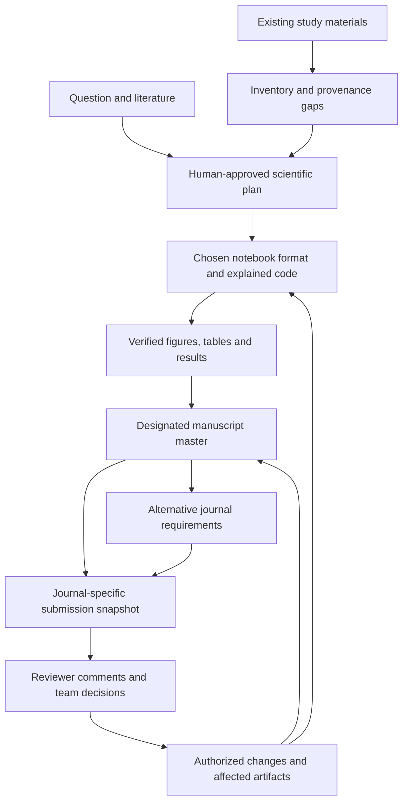

# Collaborative Research Lifecycle - Plan

## Goal Capsule

- **Objective:** A physician investigator, biostatistician, and data scientist can jointly understand, reproduce, and revise a healthcare study from its research question through journal submission and reviewer response.
- **Product authority:** The user confirmed the scope through the research-lifecycle brainstorm, including four first-class notebook formats, both manuscript workflows, and onboarding studies created outside Methodsmith.
- **Scope:** A shared study workflow spanning the three research pathways in R2; the Implementation Contract maps the agreed requirements to staged work and verification. Proposed capabilities are not claims about the current plugin.
- **Open blockers:** None for implementation planning. Technical choices and delivery sequencing are specified below; runtime and human-review prerequisites remain explicit verification dependencies.

---

## Product Contract

### Summary

Extend Methodsmith into a notebook-centered research workflow for collaborating physician investigators, biostatisticians, and data scientists.
Connect scientific decisions, code, results, manuscript claims, and reviewer responses in a record the team can inspect throughout a study.
Support new studies and existing work with incomplete provenance, while retaining human scientific authority.

### Problem Frame

A healthcare paper crosses literature searches, analysis plans, notebooks, figures, tables, coauthor edits, and journal revisions.
These artifacts can drift apart: a notebook changes without updating a reported result, a citation exists but does not support the claim, or a response letter describes work that was never verified.
The team needs to understand those connections without requiring the PI to inspect every line of code or treating an agent's recommendation as scientific approval.

The intended distinction is a continuous, inspectable study record across research and publication.
Skill counts alone do not demonstrate that outcome.
The competitive advantage is a product hypothesis to evaluate with representative lab workflows, not a measured claim of superiority.

### Actors

- A1. **Physician investigator / PI:** owns the research question, approves consequential scientific choices, and authorizes submission readiness.
- A2. **Biostatistician:** reviews design, estimands, assumptions, analysis changes, uncertainty, and interpretation.
- A3. **Data scientist:** develops and verifies code, manages execution and provenance, and produces reproducible analytical artifacts.
- A4. **Methodsmith agent:** drafts, explains, checks, connects artifacts, and surfaces unresolved decisions without impersonating a human reviewer or approver.

Roles describe responsibilities rather than requiring three different people or a new account system.

### Key Decisions

- **Four first-class notebook formats.** Governs R3-R5. (session-settled: user-directed — chosen over the narrower initial format list: marimo must be a full working format alongside Jupyter, R Markdown, and Quarto.)
- **Both manuscript workflows, one master per study.** Governs R13-R14. (session-settled: user-directed — chosen over Word-only or source-only workflows: support different collaborators without ambiguous manuscript authority.)
- **Accept externally started studies.** Governs R6-R7. (session-settled: user-approved — chosen over requiring a Methodsmith-created baseline: labs can adopt the package during an ongoing study or journal revision.)
- **All three research pathways remain in scope.** Governs R2. (session-settled: user-directed — chosen over selecting only one demonstration pathway: observational research, clinical prediction, and existing-study revision all need support.)
- **Explicit manuscript handoffs.** Governs R14. (session-settled: user-approved — chosen over automatic two-way Word/source synchronization: preserve authorship changes and identify which version is authoritative.)

### Requirements

**Scientific process and notebook work**

- R1. The workflow shall connect the research question, literature evidence, approved analysis plan, code, results, manuscript, and journal revisions without losing the provenance of scientific decisions.
- R2. The product shall support observational healthcare studies, clinical prediction/ML studies, and revision of existing studies; foundation-model projects shall use the same planning, approval, and provenance principles.
- R3. Jupyter `.ipynb`, marimo `.py`, R Markdown `.Rmd`, and Quarto `.qmd` shall be first-class choices for creating and continuing studies, without forced conversion to another format.
- R4. Material code additions and changes shall explain their scientific purpose, inputs, assumptions, and expected outputs in the notebook narrative, with links to the relevant plan or decision.
- R5. Verification shall respect each format's execution model, including Jupyter state/order, marimo reactive dependencies, and R Markdown/Quarto chunk and render behavior; unrun or stale outputs shall remain distinguishable from verified results.
- R6. Onboarding an existing study shall inventory its manuscript, code/notebooks, available source/version records, figures, tables, and submission materials while preserving the originals.
- R7. Reconstructed provenance shall distinguish verified links, inferred links awaiting review, and unknown links; the agent shall never invent a historical approval, execution, or submission baseline.

**Human authority, safety, and the study record**

- R8. Consequential scientific changes shall identify the decision, rationale, responsible human, and approval state; existing authorization shall carry forward until the proposed work exceeds it.
- R9. Sensitive data and sensitive derived artifacts, including notebook outputs and visual previews, shall remain within the approved project environment and shall not enter GitHub or another unapproved destination.
- R10. Version control shall retain appropriate code and documentation changes with their scientific rationale, while disclosure checks cover embedded outputs and other content rather than relying on filename extensions alone.
- R11. Analytical results, figures, tables, and reported numbers shall be traceable to the producing code version, execution/configuration evidence, and an appropriately protected source-data reference.
- R12. When an input, plan, code, or result changes, the workflow shall identify known dependent artifacts requiring revalidation and explicitly disclose where dependency coverage is incomplete.

**Manuscripts, journals, and evidence**

- R13. Each study shall designate either Word with editable Zotero citations or Quarto/R Markdown source as the authoritative manuscript, with related notebooks and derived submission documents identified separately.
- R14. Manuscript handoffs shall identify the source and exported versions, and subsequent edits to a derived document shall require explicit reconciliation before regeneration can replace them.
- R15. Journal adaptation shall use the target journal's current author instructions with source and retrieval date, covering applicable article type, structure, limits, citations, tables, figures, supplements, and declarations.
- R16. Formatting or transferring a submission shall preserve scientific meaning, numerical content, citation associations, and the preceding submission version, with unresolved or uncheckable requirements surfaced for review.
- R17. Citation checks shall separately report bibliographic identity/metadata verification and support for the manuscript claim, recording the evidence consulted and whether access was abstract-only or full text.
- R18. Missing, mismatched, inaccessible, or unsupported citations shall remain unresolved until addressed; the agent shall not fabricate a reference, identifier, quotation, or verification result.

**Journal revision and visual collaboration**

- R19. A revision round shall preserve the submitted manuscript and corresponding available code baseline and retain reviewer comments verbatim under stable reviewer/comment identifiers.
- R20. Each reviewer comment shall connect to the team's disposition and rationale, affected scientific/code work, verification evidence, revised manuscript location, and draft response.
- R21. Requests for clarification, reanalysis, and new scientific questions shall be distinguished; changed or additional analyses shall be labeled as post-submission work and routed through R8.
- R22. Revision history shall support multiple rounds and comments sharing the same analysis change, while distinguishing proposed, implemented, verified, and human-approved work.
- R23. Response drafting shall claim only changes supported by the revision record, including justified disagreements and partial responses for human approval.
- R24. The workflow shall provide understandable visual explanations at meaningful stages, showing the study's current step, scientific/code dependencies, consequential changes, and decisions awaiting the team.
- R25. Visuals shall carry evidence and freshness context, use only appropriately shareable content under R9, and never imply that a completed diagram or checklist establishes scientific validity.
- R26. Submission readiness shall distinguish successful automated checks, unresolved findings, and named human signoff; absent evidence or an unrun check shall never be presented as a pass.

### Key Flows

- F1. **New observational or prediction study.** A1 frames the question; A2/A3 examine literature and design; the team approves the appropriate plan; A3 and A4 develop explained notebooks and traceable outputs; the team reviews the manuscript and submission package. Covers R1-R5, R8-R18, R24-R26.
- F2. **Existing study intake.** The team supplies available study materials; A4 inventories them and reports provenance gaps; the team selects the manuscript master and confirms what can safely be executed or reconstructed. Covers R6-R10, R13-R14.
- F3. **Reviewer response.** A4 preserves the submission baseline and organizes comments; the team decides dispositions; A3/A4 implement authorized changes and identify affected outputs; A2/A1 review the evidence and responses before resubmission. Covers R8, R11-R12, R19-R26.
- F4. **Journal transfer.** The team selects another journal; A4 retrieves its requirements, assesses the current master, produces the adapted package, and reports content/citation preservation checks and unresolved requirements. Covers R13-R18, R26.

The diagram illustrates F1-F4; entry into an existing study need not rerun already verified work or invent retrospective approval.

### Acceptance Examples

- AE1. **Notebook choice is respected.** Covers R3-R5. Given the same approved synthetic demonstration task in each of the four formats, the agent preserves the selected format, explains added analytical steps, runs applicable structural/execution checks, and identifies any checks it could not run.
- AE2. **Incomplete inherited study.** Covers R6-R7, R26. Given a submitted Word paper and notebooks with no trustworthy execution/version link, onboarding preserves both, marks the link unknown, and does not claim reproduction or prior approval.
- AE3. **A stale output is visible.** Covers R5, R11-R12. When code changes after a table was generated, the workflow identifies the table and known dependent manuscript claims for revalidation rather than describing them as current.
- AE4. **Sensitive notebook output.** Covers R9-R10, R25. Given an otherwise shareable notebook containing patient-level output, preparation for GitHub or a shared preview identifies that content and prevents its inclusion without silently destroying the protected original.
- AE5. **Word changes after export.** Covers R13-R14. When a coauthor edits a Word export from a source-led manuscript, a later render does not overwrite the edits; the workflow identifies the divergent versions and requests reconciliation.
- AE6. **A real paper supports the wrong claim.** Covers R17-R18, R26. A valid DOI passes identity verification but fails or remains unresolved for claim support; the workflow does not treat reference existence as sufficient evidence.
- AE7. **A source cannot be read.** Covers R17-R18. If only an abstract is accessible, the record identifies that limit and leaves any full-text-dependent claim unverified without inventing a quotation.
- AE8. **Two comments require one reanalysis.** Covers R19-R23. Reviewer 1 comment 2 and Reviewer 2 comment 4 link to the same authorized change and its verified outputs, while each retains its own disposition and response.
- AE9. **A reviewer requests a new analysis.** Covers R8, R21-R23. The agent proposes the change and its rationale, records approval before execution outside prior authorization, labels the work post-submission, and never says it was prespecified.
- AE10. **A journal transfer changes presentation.** Covers R15-R16, R26. Adapting abstract structure and citation style preserves claims and results, retains the earlier package, and flags a requirement that cannot be checked automatically.
- AE11. **A PI inspects progress.** Covers R24-R26. A visual explanation identifies completed and unverified steps, an affected figure, and the pending scientific decision without exposing restricted content or implying approval.

### Success Criteria

Representative physician-investigator, biostatistician, and data-scientist reviewers can use the study record to explain why a material analysis choice was made, locate its supporting code and evidence, and identify unresolved decisions.
Acceptance must exercise all three pathways and all four notebook formats; equivalent support means equivalent scientific and provenance outcomes, not identical runtime mechanics.
Evaluation evidence must distinguish deterministic checks, synthetic behavioral tests, and human scientific assessment.
No accuracy, journal-acceptance, or hallucination-elimination rate is promised without a suitable evaluation.

### Scope Boundaries

Essential scope is R1-R26, including existing-study onboarding and journal revision; implementation planning may stage delivery without dropping an approved pathway or format.
New skills are warranted where an existing skill cannot own the required user outcome clearly; the number and names of skills are not prescribed here.

Deferred enhancements include a standalone desktop application, additional host integrations, and automatic two-way Word/source synchronization.
Foundation-model planning and provenance are covered by R2; a new managed training service or specialized distributed-training platform is not required by this plan.
Autonomous scientific approval, autonomous journal submission, and guarantees of clinical validity are outside this scope.

### Dependencies and Assumptions

- Existing execution, data-boundary, citation, notebook, and submission components are starting points, not proof that the complete workflow works today.
- Word/Zotero, notebook runtimes, source access, and approved storage must be available for their corresponding operations; missing capabilities must produce explicit limitations.
- GitHub may hold code and permitted documentation, but private repository visibility alone does not authorize sensitive-data storage.
- Visual delivery can use the agent's available artifact surfaces; this scope does not require a new dashboard or user-account service.
- Institutional approval and project-specific compute authorization remain separate from approving this product plan.

### Outstanding Questions

**Resolve Before Planning:** None.

**Planning questions (resolved in the Implementation Contract below):**

- Map every requirement to verified existing behavior, an extension, or a new skill, and reconcile conflicting notebook routing instructions.
- Choose the persistent study/revision record and version-control conventions that support R10-R12 and R19-R23 without excessive manual work.
- Determine how manuscript fields, notebook metadata, dependency changes, and visual freshness are verified on the supported toolchains.
- Select bounded test fixtures, human review criteria, and a delivery sequence demonstrating the full acceptance scope.
- Determine host-specific safeguards and report their limits consistently; do not imply that instruction-only controls are runtime enforcement.

### Sources and Existing Building Blocks

- `docs/audits/2026-10-27-release-readme-market-audit.md`: release, documentation, and market findings; separate release fixes must not be mistaken for completion of this product scope.
- `plugins/methodsmith/skills/method-notebook-standards/SKILL.md`: existing narrative, topology, four-format safeguards, and data-execution contract.
- `plugins/methodsmith/skills/method-notebook-edit/SKILL.md`: Jupyter-preserving edits; its preference for text-native new work needs reconciliation with R3.
- `plugins/methodsmith/skills/method-marimo/SKILL.md` and `plugins/methodsmith/skills/method-r/SKILL.md`: notebook/runtime-specific starting points.
- `plugins/methodsmith/skills/method-numbers/SKILL.md`: analysis-number registry, manuscript fields, provenance checks, and documented limits.
- `plugins/methodsmith/skills/method-citations/SKILL.md`: evidence ledger, reference checking, and editable Zotero fields.
- `plugins/methodsmith/skills/method-journal-select/SKILL.md` and `plugins/methodsmith/skills/method-submission-package/SKILL.md`: sourced journal selection, packaging, and signoff starting points.

These pointers establish available components; they do not claim the proposed end-to-end behavior is already implemented or validated.

---

## Implementation Contract

### Approach and Delivery Boundary

Add two focused entry skills: `method-study` owns study intake, provenance and status; `method-revision` owns reviewer rounds and evidence-bound responses. Extend the existing notebook, citation, manuscript, figure, number, signoff and packaging skills. Do not duplicate their analytical methods or replace their registries.

All R1-R26 are release acceptance requirements for the complete lifecycle capability. Units below stage delivery; completing an early unit does not justify advertising the full workflow. Release infrastructure defects in the linked audit remain a separate release workstream.

### Context and Grounded Research

Research was performed through Context7 MCP (marimo, Quarto, nbclient) and Exa MCP (official Zotero, Quarto, R Markdown, Git/GitHub and journal guidance), retrieved 2026-10-27. External documentation supports tool behavior; the architecture below is a design decision, not a claim made by those sources.

| Evidence | Implication for this plan |
| --- | --- |
| marimo supports lazy execution with stale descendants and separate static checks [S1] | Preserve reactive dependencies; static validation cannot mark an analysis executed. |
| Quarto `freeze: auto` responds to source changes, not all external input changes [S2] | Check declared input digests independently of render/cache status. |
| nbclient executes with explicit kernel, timeout and working directory; failed execution can still leave a saved notebook [S3] | A file's presence is not a successful run. Record execution outcome and errors separately. |
| Zotero unlinking removes editable citation fields; retain the original [S4] | Never flatten the manuscript master; record and verify handoffs. |
| Quarto supports DOCX reference styles and CSL citation processing [S5] | Style conformity and live Zotero-field compatibility require separate checks. |
| R Markdown render exposes evaluation environment and output/intermediate paths [S6] | Use an isolated R process and protected output paths for verified runs. |
| Git ignore rules do not remove tracked content; sensitive-data removal involves more than deleting a working file [S7] | Review exact staged/exported bytes and relevant outgoing history; do not promise protection from `.gitignore`. |
| Journal instructions are journal/article-specific; authors remain responsible for reference accuracy [S8] | Store dated source-backed requirements and distinguish automated checks from author review. |

Repo inspection found reusable number registries, figure manifests, signoff ledgers, submission manifests and reviewed ML run summaries. Their current existence does not establish complete dependency tracking: figure paths are not content identity; signoff entries do not bind approval to all current artifact bytes; the working package manifest is not an immutable submission baseline. Extend these boundaries explicitly.

### Key Technical Decisions

**KTD1 — A small local study record.** Store versioned JSON under an explicitly selected protected local study root, with `.methodsmith/study/` as the default only after confirming that the project location is approved. Keep original data and manuscripts in place; reference them through opaque artifact IDs. A project-local pointer may identify the protected root without exposing its sensitive paths in shared exports. Do not inherit another worktree's study state implicitly. This provides reviewable files and simple recovery without a database, server or account system (R1, R6-R12).

The record contains `schema_version`, `study_id`, `revision`, artifact IDs/types, protected locators, digests, provenance status, declared dependencies, decision references, run references, manuscript authority, and submission/revision IDs. Reuse existing number, figure and run registries through IDs instead of copying their contents. Validate unique IDs and dangling references; updates serialize writers with a local lock, check the expected revision while holding that lock, and use atomic replacement. A lock conflict returns a retryable status without applying a write. Preserve a prior valid record on failed writes. Unknown future schema versions fail closed; migrations preserve originals and produce a migration report.

**KTD2 — Content-bound evidence with honest coverage.** SHA-256 binds evidence to code bytes, dirty-worktree contents, configuration, declared data references/digests and environment records. HEAD alone is insufficient. Data hashing happens within the approved environment and is not automatically exported. A changed dependency marks known descendants stale; cycles or undeclared dependencies yield unresolved coverage, not a false all-current result. A successful run cannot establish scientific validity. Historical provenance remains verified, inferred or unknown; freshness and execution outcome are separate fields (R5, R7, R11-R12, R26).

**KTD3 — Four adapters, one evidence contract.** Keep notebook files native and preserve metadata. Jupyter verification uses a fresh kernel, explicit working directory and bounded timeout; marimo separates structural checking from clean reactive execution; R Markdown uses a fresh R process; Quarto records its engine and verifies external inputs despite cache/freeze settings. Each adapter returns success, failed, unrun or unavailable plus evidence and limitations. Runtime availability is probed at use time. Intake never executes inherited code automatically. Paid training, network access and restricted data execution stay within existing authorization and budgets (R2-R5, R8).

**KTD4 — Protected records and reviewed shared projections.** Full records, original reviewer comments, logs and notebook outputs stay protected. Generate an allowlisted, reviewed summary for GitHub or collaborators; never assume all Markdown, HTML, model files, paths or aggregate labels are safe. Resolve symlinks and containment before writes/exports. Scan exact candidate bytes and staged content, with a separate review of commits newly exposed by a push. Findings stop the Methodsmith export/PR operation without deleting originals or rewriting history. Unknown disclosure classification requires review. Hooks remain host-specific defense in depth, not a cross-platform sandbox or universal PHI detector (R9-R10, R25).

**KTD5 — One manuscript master and explicit handoffs.** Track authoritative artifact ID, format and digest. Each export records its source digest and output digest; refuse destructive regeneration when the output diverges. Reconcile edits in a new candidate with human review before changing authority. For Word, inspect DOCX citation/number fields structurally and preserve them; a successful Zotero Refresh in the supported application is separate evidence. If Word/Zotero automation is unavailable, leave that check pending for a named person. Quarto CSL output is not presumed to contain live Zotero fields (R13-R14).

**KTD6 — Separate reference identity from evidence support.** Extend the existing citation ledger with identity status, claim ID, support status, access level, source/version and consulted passage/location. Resolver failures, absent records and incomplete searches remain distinguishable. Preserve existing verifier interfaces through an explicit compatibility mapping; a legacy `FABRICATED` verdict must not be interpreted as proof of deliberate fabrication merely because lookup failed. Claims beyond an available abstract remain unverified. External content is evidence, never executable instructions (R17-R18).

**KTD7 — Dated journal profiles and preserved submissions.** Extend journal selection and packaging with a profile recording journal, article type, official source URL, retrieval date, rule evidence, verification status, and style/template identifiers. Fetch current rules at adaptation time; unavailable rules remain unresolved. Paraphrase copyrighted instructions and keep source documents local. Preserve the working manifest separately from a new immutable-by-convention submission snapshot containing artifact digests and known code/run links. Snapshot referenced submission artifacts into a protected, uniquely identified directory before recording success; a manifest of mutable paths alone does not preserve a baseline. For large restricted datasets, retain approved immutable/versioned source references rather than copying data. Never invent a submitted baseline. A digest detects later changes; it does not authenticate a person or make local files tamper-proof (R15-R16, R19, R26).

**KTD8 — Reviewer rounds are many-to-many records.** Stable round/reviewer/comment IDs link verbatim protected comments to dispositions, shared change IDs, evidence and manuscript locations. Classify clarification, reanalysis and new questions. Track proposed, implemented, verified and human-approved states separately. Suggest a branch per revision round when useful; never force a branch or commit per comment, and never push automatically. Keep prior rounds intact and carry unresolved comments forward with explicit links (R19-R23).

**KTD9 — Readable visuals from the same evidence.** Produce a local static HTML summary with a text equivalent from the reviewed projection. Show current stage, dependencies, changed artifacts, unknown/stale evidence and decisions awaiting named roles. Escape labels and comments, avoid remote assets and embedded raw values, and record the generating study revision/digest. Opening an old visual must display its snapshot identity; refreshing compares current state. The same study helper supplies human and agent views; no separate hidden agent state or UI-only approval action (R24-R26).

### Implementation Units

Paths described as new below are proposed files, not existing capabilities. Every unit retains the Product Contract IDs above.

#### U1 — Study intake and persistent record

- **Requirements/flows:** R1-R2, R6-R8; F1-F2; AE2.
- **Files:** new `plugins/methodsmith/skills/method-study/SKILL.md`, `references/study-record-schema.json`, `scripts/study_record.py`; extend `method-setup` and `method-workflow` skills.
- **Approach:** implement init, inventory, validate, status and guarded record updates using Python standard library. Preserve originals, distinguish inferred links, support protected roots and opaque artifact IDs. Route responsibilities to existing methods skills. Foundation-model work records planning, budget and run provenance through existing ML tracking rather than adding a training service.
- **Verification:** new `tests/study-record.test.ts`: incomplete inherited study; duplicate IDs; wrong study/worktree; unsupported schema; concurrent revision conflict; failed write preserves prior bytes; protected-root symlink escape. No original is altered and no execution is inferred.
- **Depends on:** none.

#### U2 — First-class notebook routing and execution evidence

- **Requirements/flows:** R2-R5, R8-R9; F1-F2; AE1, AE4.
- **Files:** extend `method-notebook-standards`, `method-notebook-edit`, `method-marimo`, `method-r`, `method-work` skill instructions and owned helpers; new adapter references/helpers inside `method-study` as needed.
- **Approach:** remove routing that discourages a user's selected Jupyter format. Preserve cell/chunk IDs and metadata; add narrative links to plans/decisions. Implement format-specific checks behind explicit runtime capability probes and execution authorization. Protect intermediates, logs and executed copies; errors must not leak row-level output.
- **Verification:** extend `tests/notebook-edit.test.ts`, `tests/fabric-marimo-skills.test.ts`; new `tests/study-notebook-evidence.test.ts`: four native fixtures, fresh execution, missing runtime, failed cell/chunk, stale cache, marimo stale dependency and timeout. An error-containing saved notebook cannot pass. No forced conversion or unapproved training run.
- **Depends on:** U1.

#### U3 — Provenance, invalidation and content-bound signoff

- **Requirements/flows:** R8, R11-R12, R26; F1, F3; AE3, AE9.
- **Files:** extend `method-study` helper/schema; `method-numbers`, `method-figure`, `method-ml-track` integration instructions; `method-signoff/references/signoff-ledger-schema.yaml` and its validator.
- **Approach:** link existing registries to artifacts/runs; compare digests and propagate stale state across declared dependencies. Introduce a versioned digest-bound signoff extension. Continue reading v1 ledgers but label approvals lacking content binding as legacy evidence requiring current verification. Never treat a recorded reviewer name as authenticated identity.
- **Verification:** extend `tests/number-registry-integrations.test.ts`, `tests/figure-workflow.test.ts`, `tests/review-pack-signoff.test.ts`; new `tests/study-provenance.test.ts`: dirty code with unchanged HEAD, modified input, unknown dependency, cycle, failed run and modified approved artifact. Independent unaffected results retain their evidence.
- **Depends on:** U1-U2.

#### U4 — Safe Git and artifact export

- **Requirements/flows:** R9-R10, R25; F1-F4; AE4.
- **Files:** extend `method-study` export helper, `method-pr/SKILL.md` and owned scripts; update setup guidance and host capability matrix.
- **Approach:** classify source artifacts and construct reviewed allowlist projections. Check exact export/staged bytes, embedded notebook output and relevant outgoing history. Provide protected remediation copies; respect existing unrelated staged changes. State which host checks are enforced, invoked or instruction-only.
- **Verification:** extend `tests/method-pr-safety.test.ts`, `tests/phi-environment-gate.test.ts`; new `tests/study-export-safety.test.ts`: synthetic sensitive canaries in notebook outputs, HTML, filenames and old commits; staged/working-copy mismatch; symlink destination; unavailable scanner; safe aggregate export. Zero canary disclosure in produced shared files or diagnostics.
- **Depends on:** U1; integrates U2-U3.

#### U5 — Manuscript authority and citation evidence

- **Requirements/flows:** R13-R14, R17-R18; F1-F4; AE5-AE7.
- **Files:** extend `method-citations/SKILL.md`, its ledger references and `scripts/verify_references.py`; manuscript handoff records in `method-study`; relevant `method-numbers` DOCX integration.
- **Approach:** implement explicit authority/export/reconcile operations and split citation identity/support/access statuses. Preserve editable master fields, bibliography associations and CE_NUM fields. Use offline resolver fixtures for deterministic tests; actual Word/Zotero compatibility requires application-level evidence.
- **Verification:** extend `tests/manuscript-citations.test.ts`, `tests/number-registry-docx.test.ts`; new `tests/manuscript-handoff.test.ts`: edited export survives regeneration attempt; authority transfer retains history; real DOI/wrong claim; abstract-only support; resolver timeout; missing identifier; citation/number fields retained. No unavailable application check becomes a pass.
- **Depends on:** U1, U3-U4.

#### U6 — Journal adaptation and submission snapshots

- **Requirements/flows:** R15-R16, R19, R26; F1, F4; AE10.
- **Files:** extend `method-journal-select` references and `method-submission-package` skill/schema/`scripts/build_package_manifest.py`; new owned journal-profile validator and snapshot helper as needed.
- **Approach:** source current article-specific requirements; separate automated formatting checks from meaning-preservation review. Keep existing working-manifest behavior compatible and add explicit snapshot creation. Preserve previous packages, source and export digests; incomplete legacy code provenance stays unknown. No implicit submission action.
- **Verification:** extend `tests/publication-artifact-registry.test.ts`, `tests/manifest-path-safety.test.ts`; new `tests/journal-adaptation.test.ts`: two synthetic journal profiles, unavailable official guidance, changed rules, altered number/citation, duplicate snapshot ID, modified source after snapshot, interrupted copy, missing source and unsafe path. Original submission remains unchanged; unresolved mandatory rules block ready-for-signoff.
- **Depends on:** U3-U5.

#### U7 — Reviewer-response workflow

- **Requirements/flows:** R8, R19-R23, R26; F3; AE2, AE8-AE9.
- **Files:** new `plugins/methodsmith/skills/method-revision/SKILL.md`, `references/revision-record-schema.json`, response templates and owned validator; route from `method-workflow` and submission skills.
- **Approach:** capture baseline references and protected verbatim comments; link comments to shared changes and verification. Draft responses only from verified change records, with explicit partial/disagree dispositions and human approval. Keep all new analyses labeled post-submission. Missing historical baseline is an intake limitation, not a reason to invent one.
- **Verification:** new `tests/revision-record.test.ts`: two reviewers share one analysis; multiple rounds; carried-forward unresolved comment; refusal with rationale; unrun promised analysis; changed evidence after approval; unauthorized new question. A response cannot claim completion from a merely proposed or implemented change.
- **Depends on:** U3-U6.

#### U8 — Visual study explanations and collaborator handoffs

- **Requirements/flows:** R4, R8, R24-R26; F1-F4; AE11.
- **Files:** new `method-study` owned HTML template/renderer; integration instructions in notebook standards, workflow and revision skills.
- **Approach:** render the reviewed projection into concise status, dependency and decision views with a text alternative. Explain scientific intent alongside code changes. Keep rendering local with no remote assets; mark stale snapshots and incomplete coverage. Human and agent actions use the same record operations.
- **Verification:** new `tests/study-visual.test.ts`: stale snapshot, unknown provenance, pending decision, escaped malicious label, keyboard/readability review and synthetic sensitive canary exclusion. PI review locates the affected figure, rationale and next decision without reading implementation code.
- **Depends on:** U3-U4, U7.

#### U9 — End-to-end evidence, documentation and distribution

- **Requirements/flows:** all R1-R26; F1-F4; AE1-AE11.
- **Files:** affected `evals/methodsmith/cases/` and per-skill `skill-creator/` sets; new synthetic lifecycle fixtures; root/plugin READMEs, `docs/setup.md`; displayed inventories and description fingerprints where affected.
- **Approach:** add observational, prediction and inherited-revision walkthroughs across all four formats. Label implemented, unavailable and manually verified steps accurately. Keep setup/install instructions synchronized and document host enforcement limits. New skills remain self-contained; use semantic skill invocation and project artifact contracts, never sibling-file imports.
- **Verification:** repository tests, release validation, eval validation and affected fresh-context behavioral cases twice each. Validate three realistic prompts and 10 trigger/10 non-trigger queries for every affected skill. Obtain task-based physician/biostatistician/data-scientist review; record disagreements and unresolved scientific checks.
- **Depends on:** U1-U8.

### Verification and Release Gates

1. **Deterministic:** run targeted tests while implementing each unit; then `bun test`, `bun run release:validate`, `bun run eval:validate`, and documented type/build checks for touched surfaces. Run `bun run legacy:fingerprints` after description changes. Do not hand-bump versions. Resolve the audit's local Python/Expat DOCX environment failure before claiming local Word tests passed.
2. **Format and pathway coverage:** maintain an explicit 3-pathway x 4-format acceptance matrix. Reuse small synthetic seeded studies; all 12 cells must demonstrate native-format preservation, execution/failure reporting, provenance and relevant manuscript/revision links. This is engineering coverage, not clinical validation.
3. **Behavioral:** use skill-creator with current source injected into fresh contexts. For each affected covered case, freeze prompt/case/target SHA-256 before dispatch and run twice independently. Every hard gate passes in both runs; save traces only under `/tmp/methodsmith/behavioral-evals/<run-id>/`. Commit sanitized evidence summaries, never live traces.
4. **Application compatibility:** verify Word/Zotero field editing and refresh in the actual supported application, and run each notebook engine. Structural checks or mocks alone do not earn application compatibility claims. Missing prerequisites leave their cells pending.
5. **Human scientific review:** representative role reviewers must locate a rationale, identify stale evidence, distinguish citation identity from support, review a post-submission analysis and approve or reject a response. Record the study revision reviewed. Agents cannot supply human signoff.
6. **Release readiness:** all essential acceptance examples pass or the release explicitly excludes the unfinished lifecycle capability from its advertised features. Separately resolve release blockers from the release/readme audit. No automatic submission, push or publication is part of this plan.

### System-Wide Impact and Failure Handling

- Existing project artifacts remain readable; optional record adoption does not require migrating every current user. Keep legacy validation separate from stronger current-evidence claims.
- Existing skills continue to work without an initialized study record; when lifecycle guarantees are requested, explain missing initialization and offer bounded intake. Do not silently report complete provenance without it.
- A partially completed run retains protected diagnostics and unresolved state. Resuming uses stored IDs and expected revisions; it does not duplicate a snapshot or assume approval survived changed inputs.
- No new cloud service, network-facing UI, mandatory MCP server, paid training backend or account system. MCP is used here for research; installed runtime behavior must state optional connector requirements and manual/offline fallbacks.
- Shared workspace files are the common human/agent interface. Agent operations return artifact IDs, statuses and safe evidence paths; they do not hide decisions in chat history or reveal raw values.
- Content scanners cannot guarantee detection of all sensitive data. Explicit classification, allowlisted outputs, approved storage and human disclosure review remain required; the plugin is not a HIPAA certification boundary.

### Considered and Not Built

- A generic workflow engine or database: simple records and existing skills cover the approved flows with fewer migration and operational burdens.
- Automatic two-way Word/source synchronization: conflicts with the settled explicit-handoff decision and risks silent loss of author edits.
- A branch for every reviewer comment: one analysis may address several comments; stable IDs provide the needed traceability without branch proliferation.
- Global notebook conversion to marimo: violates four first-class format support. Conversion remains optional and user-directed.
- Cryptographic identity/signature infrastructure: content digests detect changes; authenticating institutional signatories is outside this plugin's scope.
- A promise of zero hallucinations or automatic journal acceptance: evaluation can test evidence handling and unsupported-claim detection, not establish an absolute guarantee.

### Resolved Planning Questions and Remaining Dependencies

The earlier planning questions are resolved by KTD1-KTD9 and U1-U9: record ownership, notebook mechanics, manuscript verification, safe sharing, acceptance fixtures and delivery sequence are specified. No further product choice is required to start U1.

Execution prerequisites are capabilities to verify when reached: four notebook runtimes, a functioning DOCX Python environment, Word/Zotero application access for live compatibility checks, approved study storage and named human scientific reviewers. Missing capabilities block the corresponding verification claims, not unrelated implementation. Current journal instructions are fetched for each real adaptation; no permanent list of journal limits is assumed.

### Sources and References

- S1: [marimo runtime configuration](https://docs.marimo.io/guides/configuration/runtime_configuration/), [script checks](https://docs.marimo.io/guides/scripts/).
- S2: [Quarto project execution and freeze](https://quarto.org/docs/projects/code-execution.html).
- S3: [nbclient execution documentation](https://github.com/jupyter/nbclient/blob/main/docs/client.rst).
- S4: [Zotero word processor plugin](https://www.zotero.org/support/word_processor_plugin_usage/), [unlinking citations](https://www.zotero.org/support/kb/unlinking_citations), [moving documents](https://www.zotero.org/support/kb/moving_documents_between_word_processors).
- S5: [Quarto DOCX options](https://quarto.org/docs/reference/formats/docx.html), [Word templates](https://quarto.org/docs/output-formats/ms-word-templates.html).
- S6: [R Markdown render reference](https://rmarkdown.rstudio.com/docs/reference/render.html).
- S7: [Git ignore semantics](https://git-scm.com/docs/gitignore), [GitHub sensitive-data removal](https://docs.github.com/en/authentication/keeping-your-account-and-data-secure/removing-sensitive-data-from-a-repository).
- S8: [JAMA instructions for authors](https://jamanetwork.com/journals/jama/pages/instructions-for-authors).
- Local: `docs/solutions/skill-design/predictable-skill-authoring.md`, `docs/solutions/skill-design/behavioral-evaluation.md`, existing skill and test paths above, and the linked release audit.

### Planning Review Record

- **Classification:** unified plan; all 26 requirements, 11 acceptance examples and settled product choices retained.
- **Coverage:** sequential in-session coherence, feasibility, scope, security, design, product and adversarial checks under the repository's no-dispatch mapping. No independent or cross-model review is claimed.
- **Corrections applied:** serialize record writers before checking revisions; preserve actual submission artifact copies rather than only digests of mutable paths. These prevent lost concurrent updates and loss of the historical submission required by R19.
- **Confidence check:** strengthened the two consequential boundaries: state updates and baseline preservation. Existing safeguards cover unavailable runtimes, unsupported citation claims, stale approvals and disclosure limits; no additional service or workflow engine was justified.
- **Remaining product decisions:** none. Runtime/application checks and human scientific assessment are execution gates, not completed evidence.
- **Validation scope:** document structure, stable IDs and existing path anchors checked. No product code changed and no implementation or live behavioral tests were run in this planning step.
